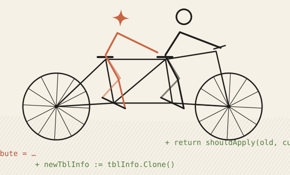

**English** | [简体中文](README.zh-CN.md)

# Tandem Review

**Human steers. Agent pedals. Review together.**

Tandem Review is a browser page where a person and a coding agent review a change together.
The agent prepares the review; the person reads, judges and comments; the agent applies the
comments; the next round begins.

It works with any agent that can write a JSON file and run a shell command: Claude Code, Codex,
DeepSeek and others.

## What the reviewer sees

1. **Overview first.** A summary of the change, the decisions that need the reviewer's call, the
   background, the approach, a diagram of where the change attaches, what is covered and what is
   not, and every file with one line on what it does.
2. **Reading order.** Functions grouped into chapters along the paths the code actually runs,
   callers before callees, so every function is read with its context. Critical functions carry a
   ⚑. A by-file view is available for reference.
3. **Notes between the lines.** The agent's explanation of each block appears as a faint line above
   the code it describes. Notes are never copied with the code and can be hidden with one key.
4. **Call hierarchy.** A side panel shows who calls the current function, from which entry points,
   and what it calls, as trees. Functions in the change jump within the page; others open in your
   editor.
5. **Comments in one batch.** Comment on a line or a range, mark it Must fix, Follow-up or Question,
   and send all comments to the agent at once. The agent replies with what it changed and the next
   round starts.

The interface is in English or Chinese; switch in the top right corner.

## Status

Design stage. The clickable prototypes in [`prototypes/`](prototypes/) use a real TiDB pull
request as sample data. Open `prototypes/app.html` from a local static server.

Planned for v1:

- `review.json`: the schema the agent writes (overview, chapters, functions, notes, call
  hierarchy, both languages).
- A local server using only the Python standard library, bound to 127.0.0.1 with a per-session
  token, that serves the page and saves comments as they are written.
- `tandem wait`: blocks until the reviewer sends comments, prints them as Markdown for the agent,
  and also writes `comments-round-N.md`.
- An agent skill that describes how to prepare a review, start the page, apply comments and begin
  the next round.

## License

[MIT](LICENSE)
