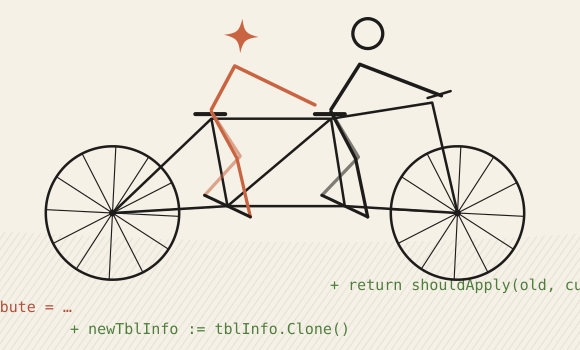

[English](README.md) | **简体中文**

# Tandem Review

<p align="center"></p>

**人掌方向，agent 出力，一起 review。**

Tandem Review 是一个浏览器页面，让人和编程 agent 一起 review 一份改动：agent 准备好讲解，
人来阅读、判断、写评论，agent 按评论修改，然后进入下一轮。

只要 agent 能写 JSON 文件、能跑命令行，就能接入：Claude Code、Codex、DeepSeek 等都可以。

## review 的人会看到什么

1. **先看总览。** 改动的总结、需要拍板的决定、背景、做法、一张「改动挂在哪」的图、覆盖了什么
   没覆盖什么，以及每个文件一句话的作用。
2. **按理解顺序读。** 函数按代码实际执行的路径分成章节，先读调用方再读被调用方，每个函数都在
   上下文里读。关键函数标 ⚑。另有按文件查看的模式。
3. **行间说明。** agent 对每段代码的讲解以淡色的一行显示在对应代码上方，复制代码时不会带上，
   一个键就能隐藏。
4. **调用关系。** 侧栏用树展示当前函数被谁调用、从哪些入口进来、它又调用了谁。改动里的函数在
   页面内跳转，其他函数在编辑器里打开。
5. **评论一次发出。** 对一行或一段写评论，分「必须改 / 后续 / 提问」，一次发给 agent。agent
   回复改了什么，进入下一轮。

界面支持英文和中文，在右上角切换。

## 安装

### 让 agent 安装（推荐）

复制下面这段话，发给你的 coding agent（Claude Code、Codex，或任何能跑 shell 命令的 agent）：

```text
帮我安装 Tandem Review：
1. 把 https://github.com/hhwyt/tandem-review 克隆到 ~/tandem-review（已经有了就 git pull）。
2. 确认 python3 是 3.9 或更新的版本。
3. 让 `tandem` 命令可用：把 ~/tandem-review/bin/tandem 链接到 PATH 里的一个目录，比如 ~/.local/bin；
   目录不存在就建，不在 PATH 里就加到我的 shell 配置文件里。
4. 安装 skill：Claude Code 就把 ~/tandem-review/skill 链接到 ~/.claude/skills/tandem-review；
   其他 agent 就把 ~/tandem-review/skill/SKILL.md 加进你的指令里。
5. 运行 `tandem --help`，把结果告诉我。
```

### 手动安装

需要 Python 3.9 或更新版本。只有往 pull request 发评论时才需要 `gh`（GitHub CLI，已登录）。

```bash
git clone https://github.com/hhwyt/tandem-review.git ~/tandem-review
mkdir -p ~/.local/bin && ln -s ~/tandem-review/bin/tandem ~/.local/bin/tandem  # ~/.local/bin 要在 PATH 里
```

给 agent 装 skill：

- **Claude Code**：`ln -s ~/tandem-review/skill ~/.claude/skills/tandem-review`
- **Codex 和其他 agent**：让 agent 读 `skill/SKILL.md`，或者把它贴进 agent 的指令里。

## 使用

对 agent 说：*「用 Tandem review 我的改动」* 或 *「用 Tandem review pingcap/tidb#123」*。agent 会：

1. 跑 `tandem preflight`，写出 `review.json`（格式见 [docs/review-json.md](docs/review-json.md)）；
2. 用 `tandem serve --review <目录> --open` 打开页面；
3. 用 `tandem wait --review <目录>` 等你看完、写评论、点发送；
4. 自己的改动：按评论修改，再 `tandem publish` 让页面自动刷新；别人的 PR：你确认后用
   `tandem post-github ... --yes` 把评论发成 GitHub 行内评论。

页面把你的设置（语言、主题、编辑器、说明开关）存在 `~/.config/tandem/prefs.json`，把 review 进度存在
review 目录里。服务只监听 127.0.0.1，每个请求都要带本次会话的 token。

不接 agent 先试一下：

```bash
mkdir -p /tmp/tandem-demo && cp examples/pr-73235/review.json /tmp/tandem-demo/
tandem serve --review /tmp/tandem-demo --open
```

## 开发

```bash
python3 -m unittest discover -s tests
node scripts/build_example.js   # 从 prototypes/ 重新生成示例
```

设计决定见 [DESIGN.md](DESIGN.md)，接口约定见 [docs/v1-contract.md](docs/v1-contract.md)，早期可点击原型在
[`prototypes/`](prototypes/)。

## 协议

[MIT](LICENSE)
